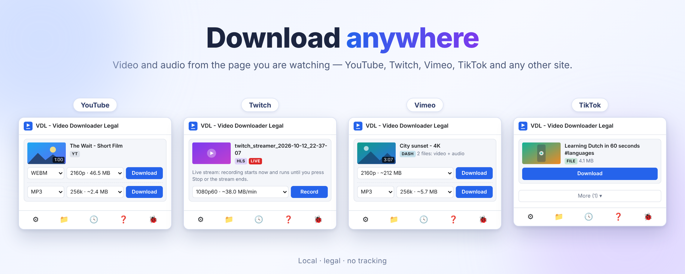
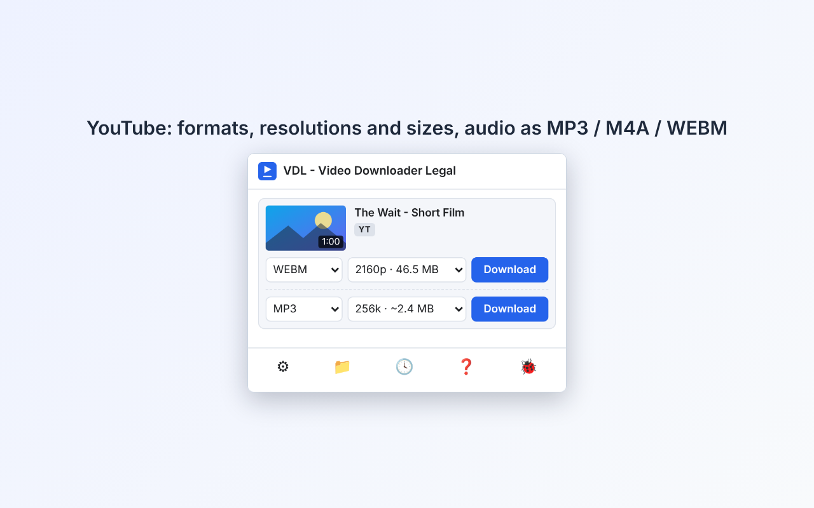
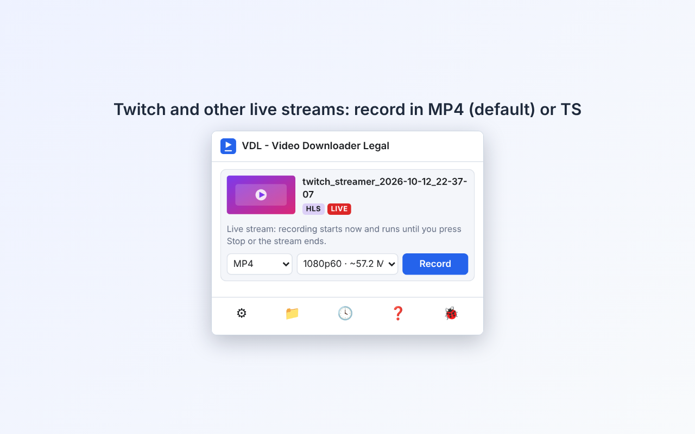
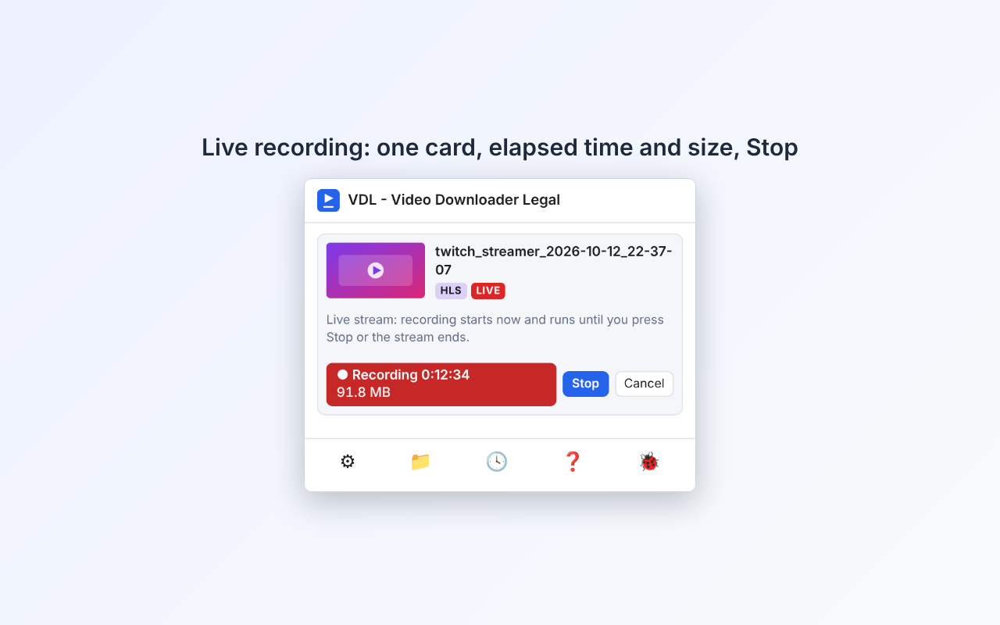
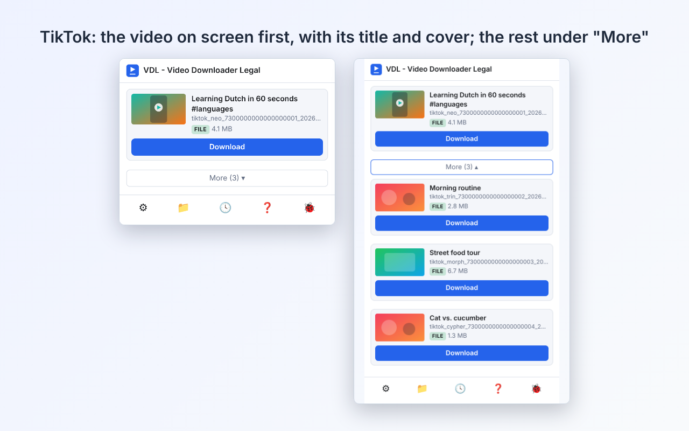
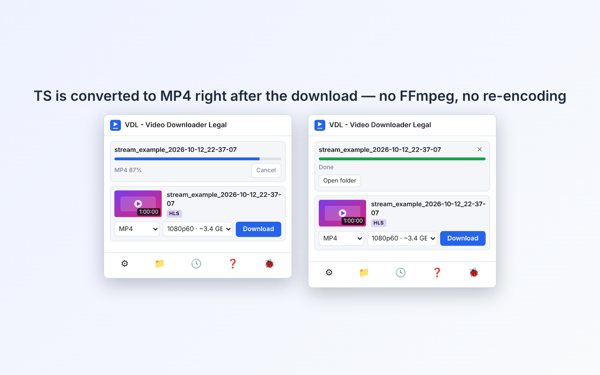
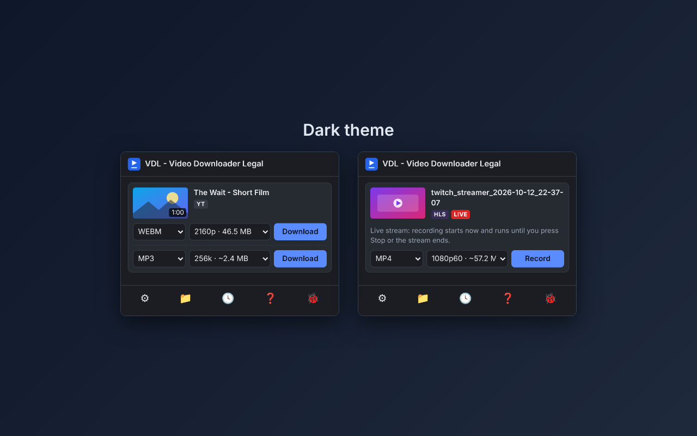
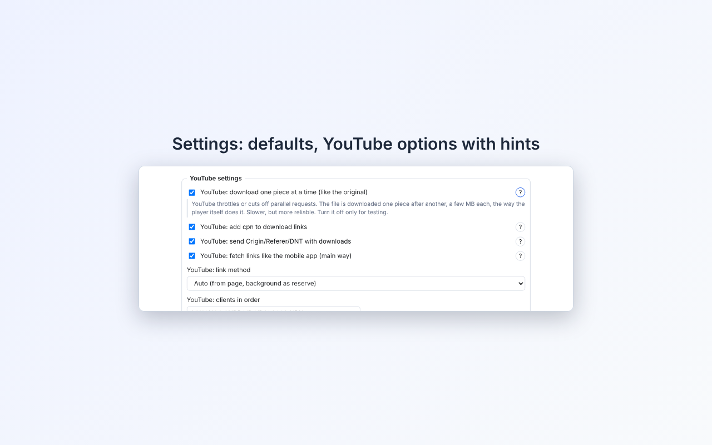
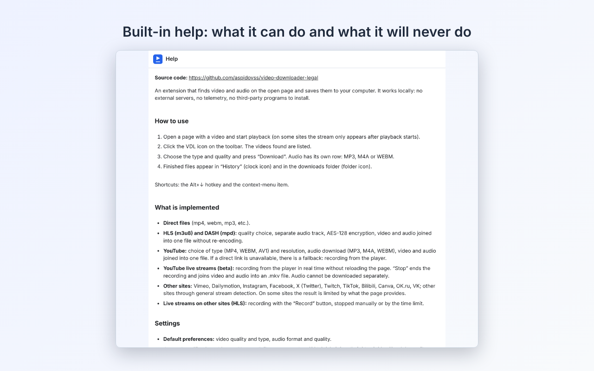

<div align="center">


# Video Downloader Legal (VDL)

**Find and save videos and audio from the page you are watching — locally, legally, with no tracking.**

[English](README.md) · [Русский](README.ru.md)

[](https://addons.mozilla.org/en-US/firefox/addon/video-downloader-legal/)

      



</div>

Video Downloader Legal is a **Firefox, Chrome and Microsoft Edge** extension (Manifest V3; other Chromium browsers such as Brave and Opera work too) that lists the videos and audio the open page plays and saves the one you choose. It also works in **Firefox for Android** (142+): open the extension from the menu *Extensions*; the popup fills the screen, downloads go to the phone's Downloads folder (no hotkeys, notifications or sidebar on Android). Everything runs inside your browser: there are no external servers, no analytics, no helper programs to install (no Native Messaging). The extension joins video and audio and converts MPEG-TS to MP4 with its **own** code, without re-encoding.

It is built to stay on the right side of the line: **DRM-protected streams are detected and refused, never decrypted**, and no tokens, signatures or credentials are forged.

Author: **AspidovSS** · License: **MIT** · Contact: <vdl@aspidov.ru>

## Features

| | |
|---|---|
| **Direct files, HLS (`m3u8`), DASH (`mpd`)** | Quality choice, separate audio track, AES-128, fMP4, byte ranges. Video and audio are joined into one file without re-encoding. |
| **YouTube** | Choose type (MP4 / WEBM / AV1) and resolution; audio as MP3, M4A or WEBM; video + audio joined into one file. If a direct link is unavailable, a fallback records from the player. |
| **Live streams** | **Twitch** and other HLS live streams: *Record* until you press *Stop* (or a time limit). **YouTube live (beta)**: recorded from the player in real time, saved as `.mp4`. Recordings start at 0:00. |
| **TS → MP4 / MKV** | HLS streams in MPEG-TS are saved as ordinary **MP4 by default** (H.264 + AAC, no re-encoding); **MKV** and **TS** are offered too, the default is set in the options. |
| **TikTok** | The video on screen is always first, with its title and cover; other videos in the feed sit under **More**. |
| **Other sites** | Vimeo, Dailymotion, RuTube, Dzen, Instagram, Facebook, X (Twitter), Bilibili, Canva, OK.ru, VK; any other site through general stream detection. Results on some sites are limited by what the page provides. |
| **Audio only** | MP3 (converted in the browser, 128–320 kbps), M4A or WEBM. |
| **Video as GIF** | Short videos (up to 3 min) can be saved as an animated GIF made right in the browser (Firefox, Chrome, Edge): width 640 / 480 / 320 / 240 px and 5–15 FPS chosen in the card, with the rough size shown beforehand; no sound. The *GIF* block of the options sets the length limit, the default width and frame rate, and on which sites GIF is offered (your own regular expressions, or all sites). |
| **Converter** | The 🎞️ button opens a page where a video or audio file from your computer becomes a GIF (with a "from–to" part), an MP3, a PNG frame, or — without re-encoding — a TS stream an MP4 / MKV and a fragmented MP4 a plain MP4. The file never leaves the browser. |
| **YouTube subtitles** | Any track of the video (also automatic ones, or a YouTube translation) as `.srt`, or with the video: a switchable track inside `.webm`, else an `.srt` next to it. |
| **Convenience** | Light and dark theme (follows your system), 10 interface languages, history, file name template, notifications, configurable hotkeys, built-in help. |
| **Diagnostics** | One button creates a local diagnostics file (links masked) that you can attach to a bug report. An optional **debug log** (options, off by default) records what the extension does; you can view, copy, save or send it, and the auto-diagnostics result is added to it. Nothing is ever sent automatically. |

Interface languages: English, Русский, 简体中文, Español, हिन्दी, Français, العربية, Português (Brasil), Deutsch, 日本語.

- **Terms of use on first run:** the popup asks you to accept that VDL is a tool provided "as is", that you download only content you have the right to, and that all legal responsibility is yours. Downloads stay disabled until you accept; you can withdraw the consent in the options.
- **Interface language:** automatic, or choose one of the 10 languages in the options; the options also have *Restore default settings*.

### What it will not do

* It does **not** bypass DRM (Widevine, FairPlay, SAMPLE-AES, `ContentProtection`) and does not decrypt protected streams.
* It does not forge tokens, signatures or sessions, and runs no remote code.
* It does not upload anything: no accounts, no servers of its own.
* Download only what you have the right to save. Respect the terms of the sites you use and copyright law in your country.

## Screenshots

| | |
|---|---|
|  |  |
|  |  |
|  |  |
|  |  |

## Install

**From Mozilla Add-ons (recommended):** open [Video Downloader Legal on addons.mozilla.org](https://addons.mozilla.org/en-US/firefox/addon/video-downloader-legal/) and press *Add to Firefox* (also in Firefox for Android).

**From a release file:** download the signed `.xpi` from the [Releases](https://github.com/aspidovss/video-downloader-legal/releases) page and open it in Firefox.

**For development (temporary):** `about:debugging#/runtime/this-firefox` → *Load Temporary Add-on…* → pick `manifest.json`. It is removed when Firefox restarts.

After installing, Firefox may ask for access to websites: open `about:addons` → the extension → *Permissions* and allow access to all sites, otherwise the page scanner cannot see the media.

Requires **Firefox 140 or newer**.

### Chrome, Microsoft Edge and other Chromium browsers (Brave, Opera) — development build

The same sources build a Manifest V3 package for Chromium. It is installed from GitHub in developer mode (it is not published in a store):

1. Get the `video-downloader-legal-chrome-<version>.zip` from the [Releases](https://github.com/aspidovss/video-downloader-legal/releases) page and unpack it, or build the folder yourself: `node scripts/build-chrome.mjs` (add `--zip` to also pack it). No npm install is needed.
2. Open `chrome://extensions` (in **Microsoft Edge:** `edge://extensions`), turn on *Developer mode*, press *Load unpacked* and pick the unpacked folder (`build/chrome`).

**Updater package (1.6.4+).** A package installed this way gets no updates from a store. `video-downloader-legal-chrome-updater-<version>.zip` (for Edge: `…-edge-updater-…`; the same files) is the same extension plus an update check: once a day it looks at the latest release here on GitHub and shows *Version X is available — Download / What's new* in the popup. To update, unpack the new archive over the old folder and press *Reload* on the extensions page. The check can be switched off in the settings (*Notify about new versions*); it sends nothing about you (see [PRIVACY.md](PRIVACY.md)). Build it with `npm run build:chrome-updater` (or `node scripts/build-chrome.mjs --zip --updater`, add `--edge` for the Edge name).

Needs **Chrome or Edge 116 or newer**. Edge runs the Chrome package unchanged (Edge-specific notes, the `video-downloader-legal-edge-<version>.zip` name and the store checklist are in [EDGE/](EDGE/README.md)). Differences from Firefox: the toolbar popup only (no sidebar), and the background runs as a service worker. Request headers are set with `declarativeNetRequest`, and the MP3 conversion and the download links are made in an offscreen document. Tested on Chromium with local servers (header rules, HLS download, MP3 conversion) and checked by hand on live sites in Chrome.

## How to use

1. Open a page with a video and start playback (on some sites the stream appears only after playback starts).
2. Click the VDL icon on the toolbar — the media found on the page are listed.
3. Pick the type and quality and press **Download** (**Record** for a live stream). Audio has its own row: MP3, M4A or WEBM.
4. Finished files appear in **History** (clock icon) and in your downloads folder (folder icon).

Shortcuts (Settings → General): <kbd>Alt</kbd>+<kbd>↓</kbd> downloads the first video, <kbd>Alt</kbd>+<kbd>Shift</kbd>+<kbd>↓</kbd> its audio, <kbd>Alt</kbd>+<kbd>↑</kbd> opens the window.

If something does not work, press the 🐞 button: it runs a short self-test, saves a diagnostics file to your downloads folder and prepares a bug-report text. If the problem is hard to reproduce, turn on the **debug log** in the options (Diagnostics), repeat the problem and save the log to a file too. Attach the file(s) to a [GitHub issue](https://github.com/aspidovss/video-downloader-legal/issues/new/choose) or send it to <vdl@aspidov.ru>.

## Supported sites — what to expect

| Site | Status |
|---|---|
| Direct files, HLS, DASH on any site | works |
| YouTube | works through several client methods; a recording fallback exists. YouTube changes often, so this is *best effort* |
| YouTube live | beta: recording from the player |
| Twitch (live) | works; MP4 or TS |
| TikTok | works; the video on screen, with title and cover |
| Vimeo, Dailymotion, RuTube, Dzen, Bilibili, Canva, OK.ru | best effort (public player data) |
| Instagram, Facebook, X (Twitter) | best effort (data of the page you are viewing) |
| DRM-protected services (Netflix, Disney+, …) | **not supported and never will be** |

## Privacy

No telemetry, no accounts, no servers of ours. Settings and history live in your browser's local extension storage. The extension talks only to the sites you are already using (and, on YouTube, to YouTube's own API and video servers), exactly as your browser would. Details: [PRIVACY.md](PRIVACY.md).

## Development

Plain, unminified JavaScript (ES modules); no build step.

**Tests:** `npm test` (Node.js 18+, `node:test`). The tests of the converters and muxers use **[FFmpeg](https://ffmpeg.org/)** (`ffmpeg` and `ffprobe` in `PATH`) to make sample videos and to check the results (frames, sound, duration, seeking); without it those tests are skipped. FFmpeg is a development tool only — it is not shipped with the extension and the extension never runs it (see [THIRD-PARTY.md](THIRD-PARTY.md#tools-used-only-for-development-not-shipped)).

Contributions are welcome — see [CONTRIBUTING.md](CONTRIBUTING.md). Want to support the project? See [DONATE.md](DONATE.md). Found a vulnerability? See [SECURITY.md](SECURITY.md).

## Project structure

Everything is plain ES modules / scripts loaded directly by `manifest.json`; there is no generated or minified code. The only third-party file, `vendor/lame.js`, is built from the unmodified lamejs sources by `scripts/build-lamejs.mjs` (see [Third-party code](#third-party-code)).

```
video-downloader-legal/
├── manifest.json            MV3 manifest: permissions, content scripts, popup, options
├── LICENSE                  MIT + notice about the third-party component
├── LICENSES/LGPL-3.0.txt    full LGPL-3.0 text (for vendor/lame.js)
│
├── service/
│   ├── main.js              background (Firefox event page / Chrome service worker): media detection,
│   │                        manifests, quality lists, downloads, live recording, TS→MP4, history, messages
│   ├── headers.js           request-header state (YouTube client UA, live HLS) + Chrome declarativeNetRequest rules
│   └── offscreen-client.js  Chrome: asks the offscreen document for blob links and MP3 conversion
│
├── platform/                Chrome only (not in the Firefox package)
│   ├── sw.js                service worker entry (shim, then service/main.js)
│   ├── shim.js              gives Chrome the `browser` namespace, Promise answers for onMessage
│   └── offscreen.html / .js offscreen document: blob: URLs for downloads, audio → MP3
│
├── scripts/build-chrome.mjs  builds the Chrome / Edge package (manifest, shim in pages and content scripts, offscreen client)
├── scripts/build-lamejs.mjs  builds vendor/lame.js from the lamejs sources and checks it against the file in the repository
│
├── lib/                     logic without browser APIs (unit-tested in Node)
│   ├── hls.js               HLS (m3u8) parser: master/media playlists, EXT-X-MAP, byte ranges, AES-128
│   ├── dash.js              DASH (MPD) parser: SegmentTemplate / Timeline / List, single file
│   ├── downloader.js        segment downloads: parallel, retries, cancel, size limit
│   ├── liverec.js           live HLS recording (re-reads the playlist, each segment once)
│   ├── mux.js               own MP4 / WebM (Matroska) parser and muxer — joins video and audio
│   ├── ts2mp4.js            MPEG-TS → progressive MP4 without re-encoding (H.264 + AAC)
│   ├── rebase.js            moves the timestamps of live recordings to 0:00
│   ├── mp3.js               decoding + MP3 encoding glue (lamejs)
│   ├── debuglog.js          debug log helpers (masking, trimming, formatting)
│   ├── blobstore.js         Blob mailbox in IndexedDB (Chrome: service worker ⇄ offscreen document)
│   ├── xmlmini.js           minimal XML parser for MPD where DOMParser is missing (Chrome service worker)
│   ├── env.js               IS_CHROME flag
│   ├── youtube.js           YouTube player response → format list (type / resolution / audio)
│   ├── ytapi.js             YouTube /player request as the official mobile apps send it
│   ├── sites.js             public endpoints: Vimeo, Dailymotion, Bilibili ("wbi" signature)
│   ├── md5.js               plain MD5, only for the Bilibili signature
│   ├── mp4info.js           compact MP4 head description for diagnostics
│   ├── sitediag.js          diagnostics helpers (URL masking)
│   └── util.js              shared helpers (extensions, formatting, file name template)
│
├── injected/                content scripts
│   ├── page.js              all pages: reports <video>/<audio>/<source> URLs (does not change the page)
│   ├── youtube_main.js      YouTube, page world, read-only: player response → relay
│   ├── youtube.js           YouTube, isolated world: relay to the background
│   ├── youtube_api.js       YouTube, page world: /player request from inside the page (on user action)
│   ├── youtube_rec.js       YouTube, page world: "Record while playing" (on user action, DRM aborts)
│   ├── tiktok.js            TikTok, isolated world: forwards the video data of the page
│   ├── tiktok_main.js       TikTok, page world, read-only: which video is on screen
│   ├── instagram.js         Instagram / Facebook: media addresses from the page's own data
│   ├── x.js                 X / Twitter: which video is on screen
│   ├── canva.js             Canva: HLS address of /watch pages
│   └── ok.js                OK.ru: stream list from the player's data attribute
│
├── content/                 extension pages
│   ├── popup.html / .js     toolbar window
│   ├── settings.html / .js  options page
│   ├── history.html / .js   download history
│   └── help.html / .js      built-in help
│
├── utils/
│   ├── dom.js               DOM helpers (textContent only, no innerHTML)
│   ├── i18n.js              UI language: browser language or the one chosen in the options
│   ├── consent.js           accepted-terms flag in storage.local
│   ├── debuglog.js          debug log in storage.local (opt-in)
│   └── settings.js          settings and history in storage.local
├── styles/ui.css            one stylesheet, light / dark by prefers-color-scheme
├── _locales/                10 languages: ar, de, en, es, fr, hi, ja, pt_BR, ru, zh_CN (identical keys)
├── icons/                   icon-48.png, icon-128.png
├── vendor/                  lame.js (lamejs 1.2.1 built from its unmodified sources, LGPL-3.0) + README with SHA-256
│
├── tests/                   node:test unit tests (parsers, downloader, muxers, background on a fake browser API)
│   └── helpers/xml.js
├── docs/                    screenshots, built-in help text, development log (Russian)
├── AMO/                     add-on listing texts, reviewer notes, privacy policy, store screenshots
├── EDGE/                    Microsoft Edge: install, build and Edge Add-ons store checklist
├── .github/ISSUE_TEMPLATE/  bug report and site request forms
└── README.md, README.ru.md, CHANGELOG.md, CONTRIBUTING.md, DONATE.md, PRIVACY.md, SECURITY.md, THIRD-PARTY.md
```

The sources are plain JavaScript (ES modules) with no bundling. Two packages are built from them: a Firefox `.xpi` and a Chrome `.zip`. You need **Node.js 18+** for the npm commands; the manual Firefox command needs only a `zip` tool.

### Firefox package (`.xpi`)

The `.xpi` contains `manifest.json`, `LICENSE`, `LICENSES`, `THIRD-PARTY.md`, `_locales`, `content`, `icons`, `injected`, `lib`, `service`, `styles`, `utils` and `vendor`. `platform/`, `scripts/`, `tests/`, `docs/`, `AMO/`, `EDGE/`, `.github/` and the documents are repository-only (`platform/` and `scripts/` belong to the Chrome build).

With npm (works on Windows, macOS and Linux):

```bash
npm install
npm run build-for-amo   # same as `npm run build`; the package appears in build/
```

`build-for-amo` is the script that AMO's automatic source builder runs. It uses `web-ext` (the only dev dependency) and packs exactly the files listed above.

Or by hand, without npm:

```bash
zip -r video-downloader-legal-ff-1.6.0.xpi manifest.json LICENSE LICENSES THIRD-PARTY.md _locales content icons injected lib service styles utils vendor
```

An unsigned `.xpi` loads only as a temporary add-on (`about:debugging`) or in Firefox Developer Edition / Nightly with `xpinstall.signatures.required` set to `false`. The release `.xpi` is signed by Mozilla.

### Chrome and Microsoft Edge package (`.zip`)

The Chrome package is made from the same sources by `scripts/build-chrome.mjs`. It takes the Firefox `manifest.json` and changes it: removes `browser_specific_settings` and `sidebar_action`, sets `minimum_chrome_version` to 116, switches the background to the service worker `platform/sw.js`, replaces `webRequestBlocking` with `declarativeNetRequest` and `offscreen`, and puts `platform/shim.js` in front of the content scripts and the extension pages. No npm install is needed (the script uses only Node's standard library).

```bash
npm run build:chrome            # build/chrome/ and build/video-downloader-legal-chrome-<version>.zip
npm run build:edge              # the same package named build/video-downloader-legal-edge-<version>.zip (Edge runs the Chrome build unchanged)
node scripts/build-chrome.mjs   # only the folder build/chrome/ (no zip)
```

The zip step calls the `zip` tool. If it is not installed (plain Windows), the script says so and leaves the folder `build/chrome/`; pack it with the built-in `tar`:

```powershell
tar -a -c -f build\video-downloader-legal-chrome-1.6.0.zip -C build\chrome .
```

Load the result in `chrome://extensions` → *Developer mode* → *Load unpacked* → the folder `build/chrome` (or the unpacked zip). It is not published in the Chrome Web Store.

## Third-party code

The only third-party file is `vendor/lame.js` — [lamejs](https://github.com/zhuker/lamejs) 1.2.1 (LGPL-3.0, text in [LICENSES/LGPL-3.0.txt](LICENSES/LGPL-3.0.txt)), used for the optional MP3 conversion. It is built from the unmodified lamejs sources (tag 1.2.1) into one readable, non-minified file. It is a JavaScript port of the [LAME](https://lame.sourceforge.net/) MP3 encoder; this project uses LAME through lamejs and thanks the LAME project. It is not covered by the MIT license of this project. See [THIRD-PARTY.md](THIRD-PARTY.md). **Rebuild it yourself:** `node scripts/build-lamejs.mjs` (Node.js 18+ and git; it fetches lamejs 1.2.1 from GitHub, rebuilds the file and prints `MATCH` when it is identical to `vendor/lame.js`; `--compare` also checks that the MP3 output equals the one of upstream's own `lame.min.js`, `--write` overwrites the file). **This project contains code generated by AI. All texts, comments and descriptions are AI-generated. All translations are AI-generated** and should be reviewed by native speakers — corrections are welcome.

## License

[MIT](LICENSE) © 2026 AspidovSS

The MIT license covers the project's own code. Exceptions:

* `vendor/lame.js` — lamejs 1.2.1, LGPL-3.0 ([LICENSES/LGPL-3.0.txt](LICENSES/LGPL-3.0.txt)); see [Third-party code](#third-party-code).
* Development tools are not part of the extension and are not distributed with it: [FFmpeg](https://ffmpeg.org/) (LGPL-2.1-or-later / GPL, depending on the build) is used only by the tests to make sample videos and check the results; [web-ext](https://github.com/mozilla/web-ext) (MPL-2.0) builds the Firefox package. The extension never runs FFmpeg and contains none of its code. Details: [THIRD-PARTY.md](THIRD-PARTY.md).
