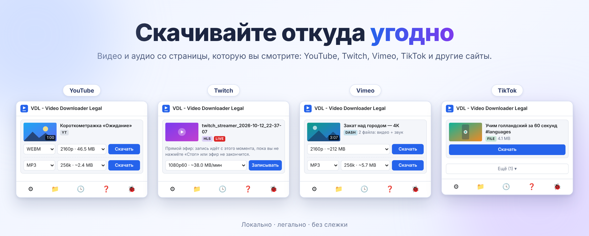
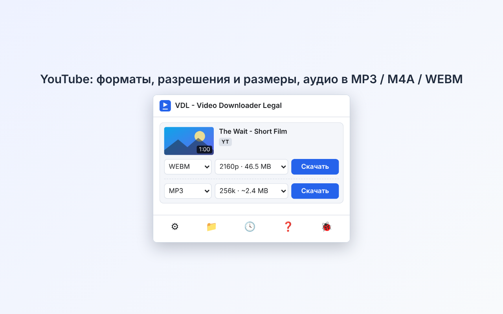
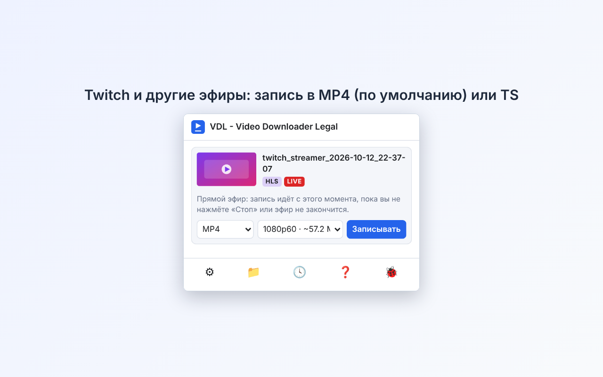
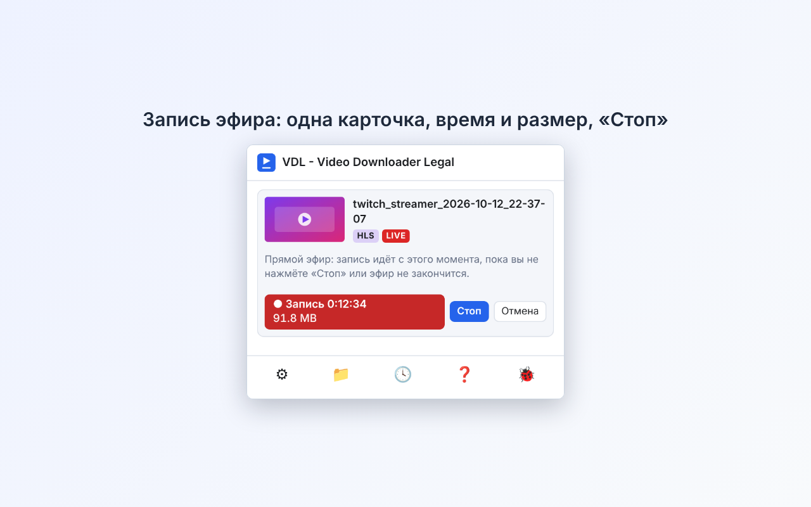
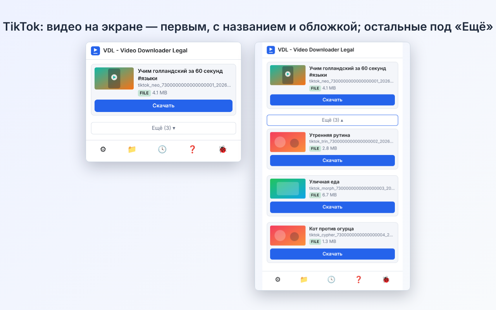
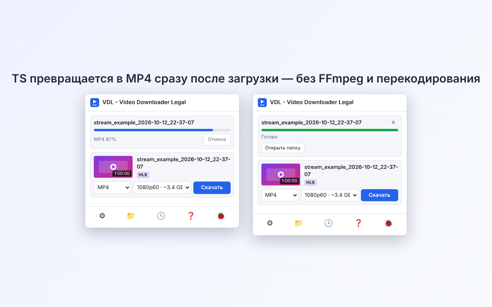
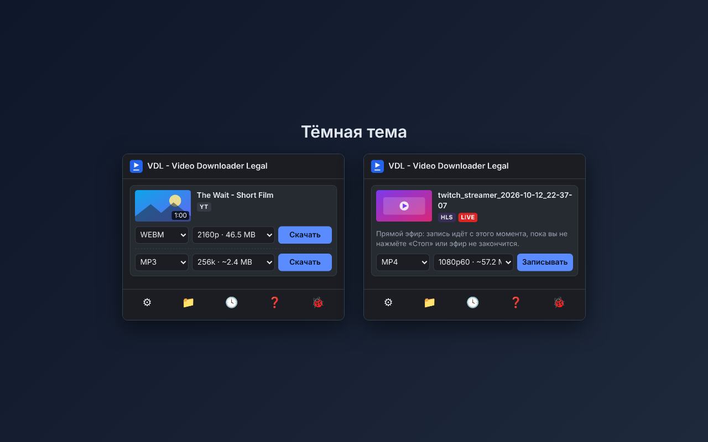

<div align="center">


# Video Downloader Legal (VDL)

**Находит видео и аудио на открытой странице и сохраняет их — локально, легально, без слежки.**

[English](README.md) · [Русский](README.ru.md)

[](https://addons.mozilla.org/ru/firefox/addon/video-downloader-legal/)

      



</div>

Video Downloader Legal — расширение для **Firefox, Chrome и Microsoft Edge** (Manifest V3; в других браузерах на основе Chromium — Brave, Opera — тоже работает): показывает список видео и аудио, которые воспроизводит страница, и сохраняет выбранное. Всё работает внутри браузера: без внешних серверов, без аналитики, без программ-помощников (нет Native Messaging). Склейку видео со звуком и конвертацию MPEG-TS в MP4 делает **собственный код** расширения, без перекодирования.

Принцип: **DRM-защищённые потоки распознаются и не скачиваются, обхода шифрования нет**, токены, подписи и учётные данные не подделываются.

Автор: **AspidovSS** · Лицензия: **MIT** · Контакт: <vdl@aspidov.ru>

## Возможности

* **Прямые файлы, HLS (`m3u8`), DASH (`mpd`):** выбор качества, отдельная звуковая дорожка, AES-128, fMP4, byte-range; видео и звук склеиваются в один файл без перекодирования.
* **YouTube:** тип (MP4 / WEBM / AV1) и разрешение; аудио в MP3, M4A или WEBM; видео и звук в одном файле. Если прямая ссылка недоступна — запасной способ: запись из плеера.
* **Прямые эфиры:** **Twitch** и другие HLS-эфиры — «Записывать» до «Стоп» или лимита времени; **YouTube live (бета)** — запись из плеера в реальном времени, файл `.mp4`. Записи начинаются с 0:00.
* **TS → MP4:** потоки HLS в формате MPEG-TS по умолчанию сохраняются как обычный **MP4** (H.264 + AAC, без перекодирования); вторым вариантом остаётся **TS**.
* **TikTok:** видео на экране всегда первое, с названием и обложкой; остальные видео ленты — под кнопкой «Ещё».
* **Другие сайты:** Vimeo, Dailymotion, RuTube, Дзен, Instagram, Facebook, X (Twitter), Bilibili, Canva, OK.ru, VK; остальные — через общий перехват потоков. Для части сайтов результат ограничен тем, что отдаёт страница.
* **Только звук:** MP3 (кодируется в браузере, 128–320 кбит/с), M4A, WEBM.
* **Субтитры YouTube:** любая дорожка видео (в том числе автоматическая или перевод YouTube) файлом `.srt` или вместе с видео: отключаемая дорожка внутри `.webm`, иначе `.srt` рядом.
* **Удобства:** светлая и тёмная тема (по настройкам системы), 10 языков интерфейса, история, шаблон имени файла, уведомления, настраиваемые горячие клавиши, справка в расширении.
* **Диагностика:** одна кнопка создаёт локальный файл диагностики (ссылки скрыты) для отчёта об ошибке. Необязательный **журнал отладки** (в настройках, по умолчанию выключен) записывает действия расширения; его можно посмотреть, скопировать, сохранить или отправить, а результат автодиагностики добавляется в него. Ничего не отправляется автоматически.

### Чего расширение не делает

* Не обходит DRM (Widevine, FairPlay, SAMPLE-AES, `ContentProtection`) и не расшифровывает защищённые потоки.
* Не подделывает токены, подписи и сессии, не выполняет чужой код.
* Ничего не загружает на серверы: нет аккаунтов и собственных серверов.
* Сохраняйте только то, на что у вас есть право. Соблюдайте условия сайтов и закон об авторском праве вашей страны.

## Скриншоты

| | |
|---|---|
|  |  |
|  |  |
|  |  |

## Установка

* **Из каталога Mozilla Add-ons (рекомендуется):** откройте [Video Downloader Legal на addons.mozilla.org](https://addons.mozilla.org/ru/firefox/addon/video-downloader-legal/) и нажмите «Добавить в Firefox» (работает и в Firefox для Android).
* **Из релиза:** скачайте подписанный `.xpi` со страницы [Releases](https://github.com/aspidovss/video-downloader-legal/releases) и откройте его в Firefox.
* **Для разработки (временно):** `about:debugging#/runtime/this-firefox` → «Загрузить временное дополнение…» → `manifest.json`. После перезапуска Firefox слетает.

После установки откройте `about:addons` → расширение → «Разрешения» и разрешите доступ ко всем сайтам, иначе сканер страницы не увидит медиа. Нужен **Firefox 140 или новее**.

### Chrome, Microsoft Edge и другие Chromium-браузеры (Brave, Opera) — версия в разработке

Те же исходники собираются в пакет Manifest V3 для Chromium; устанавливается из GitHub в режиме разработчика (в магазине не публикуется):

1. Скачайте `video-downloader-legal-chrome-<версия>.zip` со страницы Releases и распакуйте, либо соберите папку сами: `node scripts/build-chrome.mjs` (с `--zip` ещё и упакует). Установка npm не нужна.
2. `chrome://extensions` (в **Microsoft Edge:** `edge://extensions`) → включите «Режим разработчика» → «Загрузить распакованное» → выберите папку (`build/chrome`).

Нужен **Chrome или Edge 116 или новее**. Edge запускает пакет для Chrome без изменений (заметки про Edge, имя `video-downloader-legal-edge-<версия>.zip` и чек-лист магазина — в [EDGE/](EDGE/README.md)). Отличия от Firefox: только окно-попап (боковой панели нет), фон работает как service worker. Проверено в Chromium на локальных серверах (правила заголовков, скачивание HLS, MP3) и вручную на живых сайтах в Chrome.

## Как пользоваться

1. Откройте страницу с видео и запустите воспроизведение (на некоторых сайтах поток появляется только после старта).
2. Нажмите значок VDL на панели — найденные видео в списке.
3. Выберите тип и качество и нажмите «Скачать» («Записывать» для прямого эфира). Звук — в отдельной строке: MP3, M4A или WEBM.
4. Готовые файлы — в «Истории» (значок часов) и в папке загрузок (значок папки).

Если что-то не работает, нажмите 🐞: расширение выполнит короткую самопроверку, сохранит файл диагностики и подготовит текст отчёта. Если проблему трудно повторить, включите **журнал отладки** в настройках (блок «Диагностика»), повторите проблему и сохраните журнал в файл. Приложите файл(ы) к [issue на GitHub](https://github.com/aspidovss/video-downloader-legal/issues/new/choose) или отправьте на <vdl@aspidov.ru>.

## Конфиденциальность

Никакой телеметрии, аккаунтов и собственных серверов. Настройки и история лежат в локальном хранилище расширения. Расширение обращается только к сайтам, которые вы уже открыли (на YouTube — к API и видеосерверам YouTube), как это сделал бы сам браузер. Подробнее: [PRIVACY.md](PRIVACY.md).

## Разработка

Обычный JavaScript (ES-модули), без бандлера. Из исходников собираются два пакета: `.xpi` для Firefox и `.zip` для Chrome. Для команд npm нужен **Node.js 18+**. Структура проекта — в [английском README](README.md#project-structure). Журнал разработки: [на русском](docs/DEVLOG-ru.md), [in English](docs/DEVLOG-en.md). Текст справки: [docs/HELP-ru.md](docs/HELP-ru.md). Поддержать проект: [DONATE.md](DONATE.md).

### Сборка для Firefox (`.xpi`)

```bash
npm install
npm run build-for-amo   # то же, что `npm run build`; пакет появится в build/
```

`build-for-amo` — скрипт, который запускает автоматический сборщик исходников AMO; он использует `web-ext` и упаковывает ровно файлы расширения (без `platform/`, `scripts/`, `tests/`, `docs/`, `AMO/` и документов). Без npm: `zip -r video-downloader-legal-ff-1.6.0.xpi manifest.json LICENSE LICENSES THIRD-PARTY.md _locales content icons injected lib service styles utils vendor`. Неподписанный `.xpi` ставится только временно (`about:debugging`); релизный `.xpi` подписан Mozilla.

### Сборка для Chrome и Microsoft Edge (`.zip`)

```bash
npm run build:chrome            # build/chrome/ и build/video-downloader-legal-chrome-<версия>.zip
npm run build:edge              # тот же пакет под именем build/video-downloader-legal-edge-<версия>.zip (Edge запускает сборку для Chrome без изменений)
node scripts/build-chrome.mjs   # только папка build/chrome/ (без zip)
```

`scripts/build-chrome.mjs` берёт `manifest.json` для Firefox и переделывает его под Chrome: убирает `browser_specific_settings` и `sidebar_action`, ставит `minimum_chrome_version` 116, подключает фон как service worker `platform/sw.js`, заменяет `webRequestBlocking` на `declarativeNetRequest` и `offscreen`, добавляет `platform/shim.js` перед скриптами страниц. `npm install` не нужен. Для упаковки скрипт вызывает утилиту `zip`; если её нет (чистая Windows), он напишет об этом и оставит папку `build/chrome/` — упакуйте её встроенным `tar`:

```powershell
tar -a -c -f build\video-downloader-legal-chrome-1.6.0.zip -C build\chrome .
```

Установка: `chrome://extensions` → «Режим разработчика» → «Загрузить распакованное» → папка `build/chrome`. В Chrome Web Store расширение не публикуется.

## Сторонний код и ИИ

Единственный сторонний файл — `vendor/lame.js`: [lamejs](https://github.com/zhuker/lamejs) 1.2.1 (LGPL-3.0, текст в [LICENSES/LGPL-3.0.txt](LICENSES/LGPL-3.0.txt)) для необязательной конвертации в MP3. Он собран из неизменённых исходников lamejs (тег 1.2.1) в один читаемый файл без минификации. Это JavaScript-порт MP3-кодировщика [LAME](https://lame.sourceforge.net/); проект использует LAME через lamejs и благодарит проект LAME. На него не распространяется MIT-лицензия проекта. См. [THIRD-PARTY.md](THIRD-PARTY.md). **Пересобрать самостоятельно:** `node scripts/build-lamejs.mjs` (нужны Node.js 18+ и git; скрипт скачивает lamejs 1.2.1 с GitHub, собирает файл и пишет `MATCH`, если он совпадает с `vendor/lame.js`; `--compare` дополнительно проверяет, что MP3 совпадает с результатом оригинального `lame.min.js`, `--write` перезаписывает файл). **Проект содержит код, сгенерированный ИИ. Все тексты, комментарии и описания сгенерированы ИИ. Все переводы сгенерированы ИИ** и нуждаются в проверке носителями языка — исправления приветствуются.

## Лицензия

[MIT](LICENSE) © 2026 AspidovSS
